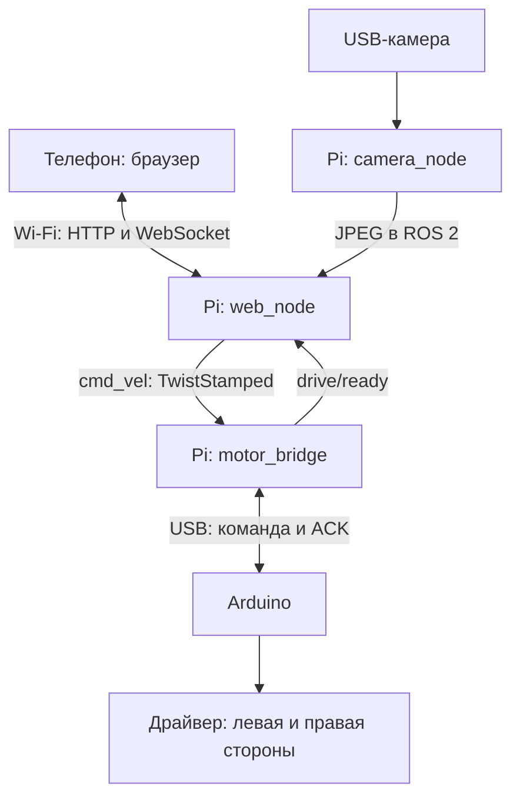

# Интерфейсы и логика управления

## Поток данных



ROS 2 установлен на Raspberry Pi. Браузер не является DDS-участником: встроенный шлюз переводит сообщения пульта в ROS 2. Всё необходимое для езды находится на Pi и Arduino. На телефоне нет ROS-библиотек; отдельный `rosbridge_server` не используется.

## ROS 2

Имена в коде относительные; `robot.launch.py` добавляет `namespace:=robot` по умолчанию.

| Топик по умолчанию | Тип | Издатель → подписчик | QoS |
|---|---|---|---|
| `/robot/camera/image_raw` | `sensor_msgs/msg/Image`, BGR8 | camera_node → инструменты ROS | best effort, depth 1 |
| `/robot/camera/image_raw/compressed` | `sensor_msgs/msg/CompressedImage`, JPEG | camera_node → web_node | best effort, depth 1 |
| `/robot/cmd_vel` | `geometry_msgs/msg/TwistStamped` | web_node → motor_bridge | reliable, depth 1 |
| `/robot/drive/ready` | `std_msgs/msg/Bool` | motor_bridge → web_node | reliable, depth 1 |

Команды от пульта публикуются 20 раз/с; состояние Arduino — 10 раз/с и немедленно false при сбое. Кадры камеры публикуются по готовности, максимум с настроенной частотой таймера. В данном проекте `cmd_vel` использует **TwistStamped**, не обычный `Twist`.

Применяются только `twist.linear.x` и `twist.angular.z`: плюс — вперёд и поворот влево соответственно. Ненулевые прочие компоненты, NaN, Inf, устаревшая или переставленная ненулевая команда выбирают нулевую скорость. Нулевая команда принимается даже без корректного timestamp.

`header.frame_id=base_link` у команды и `camera_optical_frame` у изображения — имена кадров. TF-дерево, CameraInfo, калибровка, энкодеры и одометрия этим комплектом не публикуются. Нельзя использовать фиктивную одометрию для оценки фактического пути робота.

`use_sim_time` на настоящем роботе должен оставаться false. ROS timestamps проверяются вместе с monotonic deadlines; таймер драйвера использует STEADY_TIME, поэтому пауза ROS-времени не останавливает его watchdog.

## Преобразование скорости в PWM

Для расстояния `b` между сторонами и команды `v, w`:

```text
left  = v - w*b/2
right = v + w*b/2
```

Обе стороны делятся на общий коэффициент при превышении `max_wheel_speed_mps`, чтобы сохранить соотношение. Результат масштабируется в `[-pwm_limit, pwm_limit]`. Это **открытый контур**: без энкодеров нельзя обещать реальные м/с, точное вращение или компенсацию разницы моторов. Для четырёхколёсного шасси проскальзывание при повороте тоже влияет на движение.

## HTTP и WebSocket

Все адреса относительные и обслуживаются тем же Pi на порту 8080. HTML содержит CSS и JavaScript, не загружает внешние шрифты, фреймворки или CDN.

| Запрос | Назначение |
|---|---|
| `GET /` | Страница пульта |
| `POST /api/login` | JSON `{ "password": "..." }`; сессия HttpOnly/SameSite=Strict |
| `POST /api/logout` | Отзыв сессии, закрытие её WebSocket, остановка владельца |
| `GET /api/status` | Восстановление состояния входа после перезагрузки страницы |
| `GET /api/frame.jpg` | Последний свежий JPEG, заголовок `X-Frame-Token`; иначе 503 |
| `GET /ws` | WebSocket состояния и команд |

На state-сообщениях сервер выдаёт короткоживущий случайный `challenge`, привязанный к конкретному WebSocket. Пульт возвращает его в командах, чтобы задержанный пакет не мог выглядеть новым после разрыва/остановки. Это проверка свежести, а не шифрование.

Сервер → телефон, 10 раз/с:

```json
{
  "type": "state", "authenticated": true, "armed": false, "owner": false,
  "reason": "Нажми «Взять управление»", "drive_ready": true,
  "camera_fresh": true, "challenge": "issued-random-token"
}
```

Телефон → сервер:

```json
{"type":"arm","challenge":"issued-random-token","frame":"last-displayed-frame-token"}
{"type":"drive","seq":1,"linear":0.35,"angular":0.0,"challenge":"issued-random-token","frame":"last-displayed-frame-token"}
{"type":"stop"}
```

`linear`/`angular` — конечные числа от -1 до +1. `seq` возрастает внутри включённого управления. Сервер масштабирует их в номинальные скорости из YAML. После включения команда нулевая до касания джойстика. Повторный `arm` активного владельца обнуляет движение и требует нового включения; он не сбрасывает номер последовательности для старых команд.

Владеть управлением может один WebSocket. Чужой некорректный `drive` не меняет команду владельца. **СТОП разрешён любому вошедшему зрителю**. Выход владельца, истечение его сессии или обрыв WebSocket останавливают движение. Переподключение автоматически не включает управление.

## Почему проверяется получение видео телефоном

Рабочий WebSocket ещё не означает, что оператор видит картинку. HTTP-ответ содержит токен кадра; штатный пульт возвращает его только после декодирования и отображения JPEG. Сервер принимает токен ограниченное время и проверяет исходный ROS timestamp. Поэтому зависший видеоканал приводит к остановке и при продолжающейся отправке команд.

Это механизм исправного пульта, не доказательство того, что человек действительно смотрит на экран: умышленно изменённый клиент может сообщить токен без отображения. Буферизация внутри камеры/драйвера также имеет пределы обнаружения. Timestamp камеры — время завершения `cap.read()` на Pi, не аппаратное время экспозиции. Неподвижная сцена не считается зависшим кадром по пиксельному сходству.

## USB-протокол

115200 baud, 8N1; ASCII, окончания LF, допустимо CRLF.

```text
M <uint32 sequence> <left PWM> <right PWM>*<CRC4>\n
A <same sequence> <applied left PWM> <right PWM> <flags>*<CRC4>\n
```

CRC16-CCITT-FALSE: polynomial 0x1021, init 0xFFFF, без final XOR; байты payload до `*`. Предел PWM в обеих программах — 140. ACK подтверждает принятую логическую PWM-команду; он не измеряет скорость или факт вращения колёс.

`flags`: 1 — движение заблокировано; 2 — событие watchdog; 4 — повреждённый кадр/CRC/переполнение. События очищаются после ACK. После boot/fault/watchdog Arduino держит моторы выключенными до корректной нулевой команды. Host сначала выполняет zero handshake и только затем объявляет `drive/ready=true`.

Одновременно ожидается один ACK. Несовпадающий или старый ACK не продлевает готовность. Новая нулевая команда может заменить ожидающую ненулевую. При сбое host очищает команду, закрывает serial и повторяет подключение с нулевого handshake. Arduino сама не проверяет порядок sequence: его отражение в ACK проверяет host. CRC не является защитой от намеренной подмены.

## Тайм-ауты и пределы

| Механизм | Значение в коде | Последствие |
|---|---|---|
| Штатный пульт: нет показанного свежего кадра | 500 мс от начала запроса | STOP и выключение управления |
| Штатный пульт: нет состояния сервера | 300 мс + до одного тика 50 мс | STOP / разрыв подключения |
| Сервер: нет принятой команды | 250 мс + до одного тика 50 мс | Нулевая команда, требуется включить снова |
| Challenge сервера | 300 мс | Старое сообщение отклоняется |
| ROS/получение кадра на Pi | Не более 700 мс | Запрет включения/движения |
| Команда ROS на моторном узле | 250 мс по stamp и локальному времени | Нулевой target |
| Ожидание конкретного ACK | 100 мс | Сбой соединения, ready=false |
| Дополнительный предел возраста ACK | 200 мс | ready=false |
| MCU watchdog | 350 мс с последней валидной команды | PWM=0 и блокировка |

Это интервалы разных программных уровней, а не обещание единого полного тормозного времени. Wi-Fi, USB, планировщик ОС, инерция, сцепление и силовая электроника влияют на итог. Программа не заменяет доступный физический выключатель моторного питания.

Камера читается отдельным потоком, чтобы зависший V4L2 read не блокировал ROS-исполнитель. `CAP_PROP_BUFFERSIZE=1` — запрос драйверу, не гарантия. Если `cap.read()` зависнет внутри драйвера навсегда, старые кадры перестанут считаться свежими и движение будет остановлено; для восстановления может понадобиться перезапустить launch или питание камеры. OpenCV не предоставляет универсального V4L2 read timeout.

## Windows и сеть

Базовая настройка `ROS_AUTOMATIC_DISCOVERY_RANGE=LOCALHOST` оставляет DDS внутри каждой машины. Телефон получает видео/управление по HTTP/WebSocket, поэтому ограничения multicast в WSL2 не мешают пульту. Для просмотра топиков робота откройте SSH на Pi и используйте тот же DOMAIN_ID=42 и LOCALHOST.

Установка ROS 2 в WSL2 даёт среду разработки, RViz и локальные примеры на ПК. Она сама по себе не делает топики Pi доступными внутри WSL2. Для прямого подключения RViz/узлов ПК к DDS робота потребуется отдельная настройка сети WSL2, firewall и ROS discovery; она не нужна для описанного пульта.

Не запускайте другого издателя ненулевых команд в `/robot/cmd_vel` одновременно с этим шлюзом. Пульт управляет своим входом, а ROS-топик не является механизмом аутентификации всех локальных процессов. Если позже появится автономная навигация, потребуется явный арбитр режимов и общий узел ограничения/остановки.
