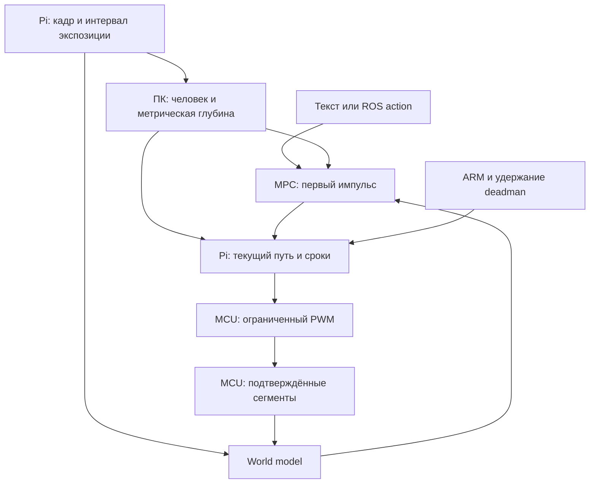

# Room World Model v2 · ROS 2 Jazzy

Исследовательский проект для **Raspberry Pi + фронтальная USB-камера + Arduino Uno R3 / classic Nano**, с восприятием, обучением и планированием на **ПК с NVIDIA GPU**. Сохранён исходный сценарий ПК с RTX 4090 и Ubuntu в WSL2. Переработка выполнена по приложенному Deep Research «Система автономности ROS 2 с камерой, текстовыми командами и learned world model для работы в одной комнате».

Задача: по команде **«подъедь к человеку и обходи препятствия»** выбирать короткие движения к одному видимому человеку, заново проверяя путь после каждой остановки. Расстановка мебели может меняться между эпизодами. World model предсказывает последствия действий; текущее восприятие и отдельный guard на Pi определяют, разрешён ли предложенный импульс.

**Поставка:** исходники контура, typed ROS messages/action, прошивка, сбор данных, обучение, оценка, примеры документов допуска, тесты и фактические отчёты. **Обученных весов для твоей комнаты нет.** Здесь выполнены программные тесты и синтетический сквозной прогон; настоящие ROS graph, камера, CUDA и моторы не проверялись. Точная граница проверки — в [TESTING_RU.md](docs/TESTING_RU.md).

**Первый запуск — `shadow`.** В конфигурации все разрешения движения выключены; при `allow_actuation: false` Pi-нода не открывает serial-порт. Размеры, скорость, торможение и параметры камеры в примере не являются измерениями твоего робота.

## Что изменилось относительно v1

| Область | Реализация v2 |
|---|---|
| Оптическое время | Прямой V4L2 MMAP/DQBUF: raw timestamp, clock/source flags, sequence, dequeue monotonic time; калиброванный интервал возможной экспозиции |
| Камера и очереди | Независимые capture/decode потоки с последним кадром; MJPG/YUYV; проверка режима и заданных V4L2 controls |
| Действие | CRC-протокол MCU версии 3, ACCEPT/START/STOP, boot/nonce/sequence, фактические ticks и границы их размещения на шкале Pi |
| ROS | Отдельный `roomwm_msgs`, атомарный `FramePacket`, typed proposal/ack/status/task/stop, `ApproachPerson.action` с feedback/result/cancel |
| Датасет | Схема v2, подтверждённые piecewise actions и нулевые промежутки только внутри известной истории; маски недостоверных переходов |
| Обучение | Train/validation/test по layout/day/session; согласованная augmentation, open-loop losses, early stopping, CUDA AMP |
| Проверка пользы | Actual / zero / shuffled actions / persistence на одной маске меток; toy closed-loop сравнение с общим reactive baseline |
| Допуск WM | Отдельные документы и флаги для ограниченного `wm_trial` и обычного `wm`; SHA256 checkpoint и fingerprint калибровки |

Соответствие рекомендациям исследования и несовместимости — в [MIGRATION_V2_RU.md](docs/MIGRATION_V2_RU.md). Версия Python-пакета — `0.2.0`; версия serial-протокола — `3`. Это разные номера; менять их для совместимости со старой прошивкой нельзя.

## Архитектура и границы задачи



Цикл: **остановка → кадр, вся экспозиция которого позже settling → расчёт → один импульс → подтверждённое выключение PWM → время физического торможения → новый кадр**. Возраст кадра и сроки проверяются на монотонных часах Pi. Часы ПК и ROS header не подменяют эту шкалу. Длительность `VideoCapture.read()` не считается возрастом изображения.

Модель — компактный recurrent ensemble: grayscale 128×128, latent 96, hidden 128, три участника, 1 960 515 параметров по умолчанию. Это собственная модель скрытой динамики с MPC/CEM; готовая универсальная политика не включена. См. [устройство модели](docs/WORLD_MODEL_RU.md).

Фактические ограничения:

- Цель — один уверенно видимый человек. Несколько людей, потеря цели, резкий скачок или достижение standoff прекращают задачу. «Ко мне» не распознаёт личность автора.
- Есть движение вперёд и небольшие дуги. Нет заднего хода, разворота на месте, поиска невидимого человека, глобальной карты или выхода из тупика.
- Разрешение требует свободного наблюдаемого пространства для всего нового swept footprint корпуса. Ближняя или боковая слепая зона передней камеры может запретить все движения. Примерная геометрия не гарантирует существование разрешённого пути.
- Предсказанная свободная зона не заменяет текущее наблюдение. При неизвестной геометрии или отсутствии подходящей дуги робот остаётся на месте.
- `obstacle_speed_bound_mps: 0.0` предполагает неподвижное окружение в пределах одного цикла. Произвольно движущиеся люди и предметы этим предположением не покрываются.
- PWM и ticks подтверждают электрическое задание, но не измеряют скорость, проскальзывание или полную остановку колёс. Для этого нужны физические измерения, а при расширении задачи — дополнительная обратная связь.
- Оператор наблюдает опыт и удерживает deadman. Сбор и исполнение используют одинаковый предел импульса и проверку пути.

## 1. Установить окружение и собрать ROS interfaces

Примеры предполагают **Ubuntu 24.04 / ROS 2 Jazzy / системный Python 3.12** и каталог `room_world_model_v2`. На Pi нужен 64-битный Linux. Прямой V4L2 backend поддерживает Linux x86_64/aarch64 и single-planar progressive MJPG/YUYV. `.venv` между архитектурами не переносится.

На обеих машинах после установки ROS 2 Jazzy:

```bash
sudo apt install python3-venv python3-pip python3-colcon-common-extensions \
  ros-jazzy-rosidl-default-generators ros-jazzy-std-msgs \
  ros-jazzy-sensor-msgs ros-jazzy-std-srvs ros-jazzy-action-msgs
source /opt/ros/jazzy/setup.bash
python3 -m venv --system-site-packages .venv
source .venv/bin/activate
python -m pip install --upgrade pip
```

На **Pi**:

```bash
python -m pip install -e '.[pi]'
```

На **ПК** сначала установи PyTorch с CUDA для своего драйвера по [официальной инструкции PyTorch](https://pytorch.org/get-started/locally/), затем:

```bash
sudo apt install python3-tk libgl1 libglib2.0-0 g++
python -m pip install -e '.[ml,test]'
python -c 'import torch; print(torch.__version__, torch.cuda.is_available())'
```

`[pi]` использует headless OpenCV, `[ml]` — обычный OpenCV для Ultralytics. Это наборы для разных машин; не устанавливай оба в одну среду. Для CPU-only программной проверки достаточно `numpy`, `PyYAML`, `Pillow`, CPU PyTorch, OpenCV, `pytest`, `pyserial` и `g++`; perception-веса не нужны.

**На каждой машине обязательно собрать два ROS-пакета:**

```bash
bash scripts/build_ros.sh
source scripts/ros_env.sh
python -c 'import rclpy; from roomwm_msgs.msg import FramePacket; from roomwm_msgs.action import ApproachPerson; print("ROS interfaces OK")'
```

`room_world_model` — внешний `ament_python` пакет, `ros2/roomwm_msgs` — вложенный `ament_cmake` пакет. Скрипт явно передаёт оба пути в colcon: обычный рекурсивный поиск остановился бы на внешнем пакете. Один `pip install` не генерирует `.msg` и `.action`.

В каждом новом терминале:

```bash
source .venv/bin/activate
source scripts/ros_env.sh
```

Скрипт задаёт `ROS_DOMAIN_ID=42`, discovery `SUBNET` и подключает `ros_install/setup.bash`. Для WSL2 отдельно настрой доступность Pi и DDS discovery; порядок и диагностика — в [OPERATING_RU.md](docs/OPERATING_RU.md). Скрипт сеть и firewall не меняет.

## 2. Первый пассивный запуск

На Pi проверь реальный режим камеры:

```bash
python -m room_world_model.calibrate v4l2-probe \
  --config config/robot.yaml --frames 120 --output calibration/v4l2_probe.json
```

На ПК один раз скачай perception-модели, заранее выбрав и закрепив revision depth-модели в конфигурации:

```bash
python -m room_world_model.download_models --config config/robot.yaml
```

Детектор по умолчанию — YOLO11n, глубина — Depth Anything V2 Metric Indoor Small. Их кэш требуется только ПК. Загрузчик не обучает world model и не открывает motor-порт. Для реальных записей используй один закреплённый набор моделей на пути collection → label → runtime.

В отдельных терминалах:

```bash
# Pi
python -m room_world_model.ros_pi --config config/robot.yaml
```

```bash
# ПК: восприятие, диагностика, предложения без исполнения
python -m room_world_model.ros_pc --config config/robot.yaml --mode shadow
```

```bash
# ПК: окно оператора
python -m room_world_model.operator
```

Пока `camera.timing.accepted: false`, изображения пригодны для диагностики, но не подтверждают экспозицию для движения или обучения динамики. Это штатный результат первой пробы. На ПК проверь `ros2 topic echo /roomwm/status --once` и `ros2 topic hz /roomwm/frame --qos-reliability best_effort`.

## 3. Измерить камеру, обзор и привод

Полный порядок с CLI и форматами измерений:

- [DATA_AND_CALIBRATION_RU.md](docs/DATA_AND_CALIBRATION_RU.md): intrinsics, rectification, pose, масштаб depth, V4L2 SOE/EOF, LED/GPIO fit и независимый check, coverage footprint.
- [HARDWARE_AND_SAFETY_RU.md](docs/HARDWARE_AND_SAFETY_RU.md): распиновка, прошивка, одиночный commissioning pulse, направление, задержки, скорость, торможение, watchdog и serial faults.

V4L2 timestamp/flags дают происхождение времени. Само их наличие не подтверждает оптическую точность. Для SOE/EOF нужны измеренные uncertainty/readout bounds; для EMPIRICAL — граница скрытой задержки с независимой проверкой. Калибратор оставляет `accepted: false` до разбора результатов человеком.

Отдельный порог обучения — `camera.max_training_exposure_uncertainty_s: 0.10`: **половина ширины интервала**, не максимальный возраст кадра. Интервал `[dequeue−0.8 s, dequeue]` слишком широк для обучения при этом пороге, даже если его возраст допустим для медленного stop-observe цикла. Число нельзя уменьшать в отчёте без более точного измерения.

После измерений принимаются геометрия `camera.json`, `camera.timing` и конфигурация робота. Для teleop/baseline дополнительно нужны явные `runtime.calibration_confirmed`, `runtime.allow_camera_only_research` и `runtime.allow_actuation`. WM-флаги остаются выключенными. Перезапусти узлы после изменения файлов; объявление примерных чисел «принятыми» не заменяет калибровку.

## 4. Собрать независимые реальные сессии

Для каждой независимой комбинации условий меняй **и** `runtime.record_session`, **и** `session.session_id/layout_id/day_id/lighting_id`. Например, `sessions/real/day1_layout_a`. Manifest сессии неизменяем: другой конфиг требует новой сессии.

Для первых эпизодов на ПК работает один контроллер:

```bash
python -m room_world_model.ros_pc --config config/robot.yaml --mode teleop
```

В окне выбери направление, визуально подтверди полную остановку, отметь checkbox, переведи фокус из текстового поля, удерживай пробел и нажми `ARM`. Новая цель отменяет прежнее разрешение. Отпускание, потеря фокуса, Escape, старый кадр или ошибка связи/привода останавливают и требуют нового явного ARM. Во время одного удержания повторяется цикл с новыми кадрами.

**Для ручного переноса робота или перестановки сцены:** STOP → дождаться физического покоя → штатно завершить Pi-ноду и запись → переставить → запустить новую запись. Для нового layout/day/lighting сначала изменяются идентификаторы сессии. Это исключает ручной перенос из перехода «нулевой PWM → другое изображение».

При неподвижном роботе можно разделить запись без перезапуска:

```bash
ros2 service call /roomwm/new_episode std_srvs/srv/Trigger '{}'
```

Сервис сразу открывает следующий эпизод, **не приостанавливает запись на время переноса**. Сохраняй raw RGB и `events.jsonl`; средняя команда, `TwistStamped` и один поток изображений не восстанавливают подтверждённую историю MCU.

## 5. Экспортировать, разметить, обучить

Закрой записи штатно и перенеси на ПК целые сессии. Из корня проекта:

```bash
python -m room_world_model.record --session sessions/real --output data/unlabelled
python -m room_world_model.label data/unlabelled/EPISODE.npz \
  --output data/labelled/EPISODE.npz --config config/robot.yaml --device cuda
```

`EPISODE.npz` — фактическое имя экспортированного эпизода; разметку повторяют для нужных файлов. Сохраняй взаимное расположение raw RGB и NPZ. Export требует подтверждённый начальный ноль, парные MCU START/STOP и известное покрытие всей экспозиции. Неизвестные действия не превращаются в нули; недостоверные переходы маскируются, несовместимые записи отклоняются. Пассивная камера без MCU handshake не становится датасетом динамики.

Разметка через `--config` проверяет fingerprint камеры, геометрии и учителя. Teacher depth не является измеренной истиной: проверь реальные расстояния, тонкие/тёмные/отражающие препятствия и завышение свободного пространства. Поддержаны маски и ручные corrections.

Для train/validation/test нужно минимум три независимые группы выбранного типа; это минимальное условие разделения, не достаточный объём данных. Базовый эксперимент:

```bash
python -m room_world_model.train --data data/labelled --output runs/room_v2 \
  --epochs 30 --batch-size 8 --sequence-length 6 --burn-in 2 \
  --latent-dim 96 --hidden-dim 128 --ensemble-size 3 \
  --split-by layout --validation-fraction 0.2 --test-fraction 0.2 --device cuda
python -m room_world_model.evaluate --checkpoint runs/room_v2/best.pt \
  --data data/labelled --split test --output runs/room_v2/test_ablation.json --device cuda
```

`best.pt` выбирается по validation. `--split test` исключает train и выборочную validation, выявляет точные копии записей. Альтернативные оси — `--split-by day` и `session`; сессия всегда остаётся неделимой. Длительность и порядок сегментов — вход модели; усреднённое `actions` хранится для диагностики.

Проверь actual/zero/shuffled/persistence, ошибки по горизонту и опасные ошибки геометрических меток. Одного снижения train loss недостаточно. Параметры, метрики и маски — в [WORLD_MODEL_RU.md](docs/WORLD_MODEL_RU.md).

## 6. От shadow к ограниченному опыту с WM

Сначала проверка своей модели без исполнения предложений:

```bash
python -m room_world_model.ros_pc --config config/robot.yaml --mode shadow \
  --shadow-controller wm --checkpoint runs/room_v2/best.pt
```

Для исходного сравнения запускай `--mode baseline` с теми же физическими ограничениями и сценами. Затем предусмотрены два этапа:

1. **Ограниченные WM trials:** reviewed ablation на реальных held-out данных, SHA256 checkpoint и fingerprint калибровки, документ `world_model_trial_file`, отдельный `allow_wm_trials: true`. На ПК — `--mode wm --wm-trial`. Этап позволяет собрать реальные сравнительные испытания.
2. **Обычный WM:** дополнительно reviewed paired реальные испытания baseline/WM, документ `world_model_acceptance_file` и `world_model_validated: true`; на ПК — `--mode wm` без `--wm-trial`.

Примеры — `examples/wm_trial_eligibility.example.json` и `examples/wm_acceptance.example.json`. Они заведомо не дают допуска: `reviewed: false`, нет реальных evidence и метрик. Валидатор проверяет поля и соответствие checkpoint/config; он не доказывает добросовестность внешнего отчёта и не заменяет анализ эксперимента. Полный порядок — в [MIGRATION_V2_RU.md](docs/MIGRATION_V2_RU.md).

Обучение и synthetic smoke не включают разрешения. Весá не обновляются во время движения. Даже после допуска сохраняются current-perception gate, uncertainty, ARM, удержание и MCU watchdog.

## 7. Текстовая команда и ROS action

Для baseline или допущенного WM команда доступна из окна оператора или action client:

```bash
python -m room_world_model.goal_client \
  'подъедь к человеку и обходи препятствия' --standoff 1.0 --timeout 120
```

`--standoff` должен совпадать с `perception.person_standoff_m`. Action `/roomwm/approach_person` возвращает фазу, видимость/дистанцию и число подтверждённых импульсов, затем результат. Клиент **не выдаёт ARM**: после принятия цели используются окно, подтверждение остановки и удержание. Ctrl+C публикует STOP и запрашивает cancel. Новая цель не наследует lease предыдущей.

```bash
python -m room_world_model.goal_client 'стоп'
```

Неизвестная фраза также означает остановку. Это ограниченный набор команд, без LLM, распознавания личности или исполнения произвольного текста. ROS API, QoS и диагностика — в [OPERATING_RU.md](docs/OPERATING_RU.md).

## 8. Проверить программы без робота

```bash
python -m pytest -q
python -m room_world_model.smoke --output runs/smoke_v2
```

Или `bash scripts/smoke.sh`: тот же CPU synthetic pipeline и затем тесты. Smoke создаёт шесть synthetic layouts, обучает крошечную модель, выполняет held-out ablation и четыре paired toy-сценария. Он не открывает камеру/serial и не скачивает perception-веса. Его веса запрещены для живого исполнения.

В фактически выполненном smoke модель **не показала полезного управления**: pixel MSE хуже persistence, action ablation почти не меняет ошибку, reactive достиг цели в 1/4 toy-сценариев, WM — в 0/4 и выбирал STOP. Это проверка работоспособности программного контура, не готовности автономности. Отчёты находятся в `validation/` и разобраны в [TESTING_RU.md](docs/TESTING_RU.md).

## Файлы и переход с v1

| Путь | Содержимое |
|---|---|
| `room_world_model/` | Камера, timing, MCU adapter, запись, perception, WM, обучение, MPC и ROS |
| `ros2/roomwm_msgs/` | 11 ROS messages и `ApproachPerson.action` |
| `firmware/roomwm_drive/` | Pulse-only прошивка ATmega328P, CRC-протокол 3 |
| `config/` | Пример с выключенным движением и непринятыми калибровками |
| `scripts/`, `launch/` | Сборка, окружение, smoke и launch-файлы |
| `examples/`, `docs/` | Документы допуска и подробные русские инструкции |
| `tests/`, `validation/` | Fault injection, вычислительные проверки, фактические отчёты |
| `MANIFEST.sha256` | Контрольные суммы файлов поставки |

V1 NPZ/checkpoints и прежний serial-протокол не совместимы с v2. Диагностика старого файла: `python -m room_world_model.data --audit-v1 OLD.npz`. Поля, которых не было в журнале, нельзя восстановить переименованием ключей. Сохрани v1 отдельно; собери новые записи с временными границами и MCU-подтверждениями, затем переобучи модель. Если есть полноценные исходные доказательства, возможен отдельный проверенный re-export; автоматическая подстановка времени или ACK не предусмотрена.
